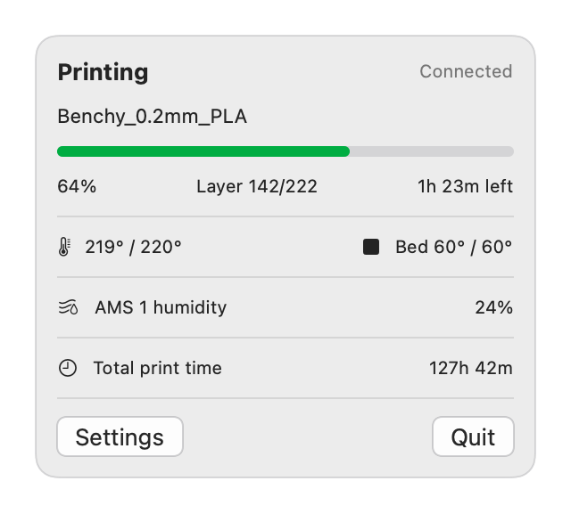

# BambuBar

A tiny macOS menu bar app that shows the live status of your **Bambu Lab** 3D printer – progress, time left, temperatures, AMS humidity – without opening Bambu Studio or the phone app.

<p align="center">
  
</p>

*(Screenshot rendered with sample data.)*

## Features

- **Live print status** – printing, paused, finished, failed, idle
- **Menu bar at a glance** – bamboo icon plus progress and time left while printing
- **Details in the popover** – job name, progress bar, layer count, nozzle and bed temperature
- **AMS humidity** – per AMS unit, in % where the hardware reports it (otherwise as a 1–5 level)
- **Total print time** – accumulated while BambuBar is running
- **English and German** – follows your system language, or pick one in Settings
- **Local only** – talks directly to the printer on your network, no cloud, no account

## Requirements

- macOS 13 or newer
- A Bambu Lab printer on the same network as your Mac, with **LAN mode** enabled (newer firmware may also need *Developer mode*)
- The printer's **IP address**, **serial number** and **access code** (all shown on the printer's screen under *Settings → WLAN* / *Device*)

## Build and run

```bash
git clone https://github.com/kopytjuk/bambubar.git
cd bambubar
./build_app.sh
open build/BambuBar.app
```

The script builds a release binary and wraps it into `build/BambuBar.app` (menu bar only, no Dock icon, ad-hoc signed). macOS may ask you to allow local network access on first launch – that is required to reach the printer. If Gatekeeper blocks the app, right-click it and choose *Open*.

For development you can also run `swift run`.

## Setup

1. Click the bamboo icon in the menu bar and choose **Settings**.
2. Enter the printer's IP address, serial number and access code.
3. Press **OK** – BambuBar connects and reconnects automatically if the connection drops.

Tip: give the printer a fixed IP address in your router so the setting never goes stale.

## How it works

Bambu Lab printers expose an MQTT broker on port `8883` (TLS, user `bblp`, password = access code). BambuBar subscribes to `device/<serial>/report`, asks the printer for a full status dump, and merges the partial updates it keeps sending. The MQTT client is a ~200-line implementation on top of `Network.framework`, so there are no dependencies.

The printer uses a self-signed certificate, so BambuBar does not verify it. Only use the app on a network you trust.

## Limitations

- Works on the local network only (use a VPN to reach your home network from elsewhere).
- The printer does not report its lifetime print hours over MQTT, so *Total print time* only counts what BambuBar has observed itself.
- Settings, including the access code, are stored in the app's `UserDefaults` (not the Keychain).
- Developed and tested against one printer setup; other models may report fields differently.

## Project layout

| Path | Purpose |
| --- | --- |
| `Sources/BambuBar/MQTT.swift` | Minimal MQTT 3.1.1 client |
| `Sources/BambuBar/PrinterModel.swift` | Printer state and translations |
| `Sources/BambuBar/BambuBarApp.swift` | Menu bar UI and settings window |
| `Sources/BambuBar/BambooIcon.swift` | Bamboo glyph used for the icons |
| `build_app.sh` | Builds `BambuBar.app` |
| `tools/make_icon.sh` | Regenerates `Resources/AppIcon.icns` |

Regenerate the screenshot with `swift build && .build/debug/BambuBar --screenshot docs/screenshot.png`.

## Disclaimer

BambuBar is an unofficial community project and is not affiliated with or endorsed by Bambu Lab.

## License

[MIT](LICENSE)
